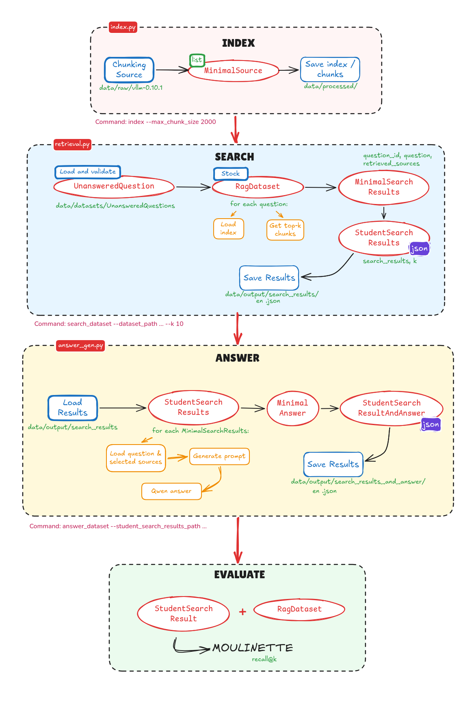
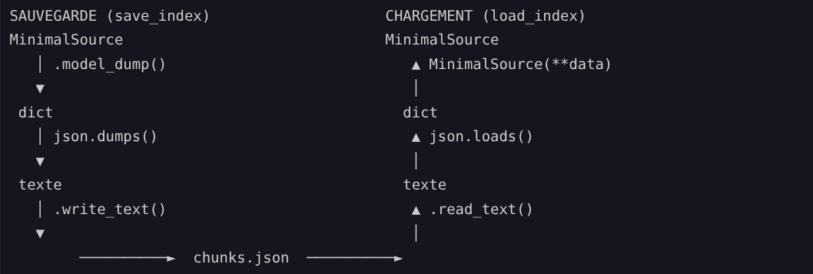

*This project has been created as part of the 42 curriculum by gmach.*

# Description

**RAG against the machine** is a Retrieval-Augmented Generation system that
answers questions about the [vLLM](https://github.com/vllm-project/vllm)
codebase (version 0.10.1, in `data/raw/`).

It works in four stages, each one feeding the next:

1. **Index**: split every `.py`, `.md` and `.txt` file into chunks of at most
   2000 characters and build a BM25 index under `data/processed/`.
2. **Search**: for a question, return the top-k chunks as source locations
   (`file_path` + character range).
3. **Answer**: give these chunks to **Qwen3-0.6B**, which answers using only
   them, or refuses when they do not contain the answer.
4. **Evaluate**: measure the retrieval quality with recall@k against
   reference datasets.

Everything is driven by a CLI built with Python Fire.

# Instructions

**Requirements:** Python ≥ 3.13 and [uv](https://docs.astral.sh/uv/).
A GPU is used when available, otherwise everything runs on CPU.

```bash
uv sync        # install every dependency (torch, transformers, bm25s, ...)
```

Every command is run as `uv run python -m src <command> [options]`:

| Command | What it does |
|---|---|
| `index --max_chunk_size 2000` | Chunk `data/raw/` and save the index in `data/processed/` |
| `search "<query>" --k 10` | Print the top-k sources for one query |
| `search_dataset --dataset_path <file> --k 10 --save_directory <dir>` | Search a whole dataset, write a `StudentSearchResults` JSON |
| `answer "<query>" --k 10` | Answer one query from the retrieved sources |
| `answer_dataset --student_search_results_path <file> --save_directory <dir>` | Answer a whole search results file, write a `StudentSearchResultsAndAnswer` JSON |
| `evaluate --student_search_results_path <file> --dataset_path <file>` | Print our own recall@1/3/5/10 against an `AnsweredQuestions` dataset |

The **Makefile** wraps them:

| Target | What it does |
|---|---|
| `make install` | `uv sync` |
| `make index` | Build the index |
| `make search` / `make answer` | One query, e.g. `make answer QUERY="..." K=5` |
| `make search-dataset` | Search `UNANSWERED_DATASET`, save in `SEARCH_SAVE_DIR` |
| `make evaluate` | Our recall of `SEARCH_RESULTS_PATH` against `EVALUATE_DATASET` |
| `make answer-dataset` | Answer `SEARCH_RESULTS_PATH`, save in `ANSWER_SAVE_DIR` |
| `make run` | `params` + the whole pipeline: index → search → evaluate → answer |
| `make params` | Print the current value of every parameter |
| `make lint` / `make lint-strict` | flake8 + mypy (subject flags / `--strict`) |
| `make clean` | Remove `__pycache__` and `.mypy_cache` |
| `make debug` | Run the CLI under `pdb` |

Every parameter can be overridden on the command line, e.g.
`make search-dataset K=5 UNANSWERED_DATASET=data/datasets/UnansweredQuestions/dataset_code_public.json`.
An unknown target stops with the list of the valid ones.

# System architecture



| Module | Role |
|---|---|
| `data_models.py` | Pydantic models exchanged between the stages |
| `index.py` | Read the corpus, chunk it, build / save / load the BM25 index |
| `retrieval.py` | `Retriever` (index loaded once) and `search_dataset` |
| `answer_gen.py` | `Generator` (Qwen loaded once) and `answer_dataset` |
| `evaluate.py` | recall@k against a verified dataset |
| `output.py` | CLI: argument checks, calls, printing |
| `__main__.py` | Fire entry point, turns every error into a clean message |

# Chunking strategy

Every chunk is a `MinimalSource` whose text is exactly
`file[first_character_index:last_character_index]` (checked by a pydantic
validator), so a result always points to a real place in the corpus.

**Markdown / text (`.md`, `.txt`): by sections.**
1. Cut before each title line (`#`, `##`, ...), ignoring the `#` inside
   ```` ``` ```` code blocks.
2. Merge consecutive sections as long as the result stays ≤ `max_chunk_size`,
   so that short sections do not become tiny chunks.
3. Split a section still longer than `max_chunk_size` into fixed-size pieces.

In `.txt` files (`CMakeLists.txt`, `requirements*.txt`), `#` starts a
comment: chunks then begin right before a comment, which usually introduces
the block that follows.

**Python (`.py`): fixed-size windows of `max_chunk_size` characters.**
This looks naive, but it was measured as the best choice: the expected
sources of the code dataset are arbitrary windows of ~900 characters that
often start in the middle of a function. Cutting along `def` / `class`
lines was tested and gave a *lower* recall@5 (55.6 % vs 59.6 %).

No overlap between chunks: it doubled the number of chunks, filled the top-k
with near-duplicates and did not improve recall.

# Retrieval method

**BM25** with the [`bm25s`](https://github.com/xhluca/bm25s) library and
English stopwords.

- **File path words are indexed with each chunk.** Before indexing, the words
  of the path are added in front of the chunk text:
  `fused_moe/fused_batched_moe.py` → `fused moe fused batched moe py`.
  A question about "the fused batched MoE layer" then matches the file name,
  even when these words are not in the chunk itself. Only the indexed text
  changes: the stored chunks and the context given to Qwen stay the same.
- Chunks with a null score (no word in common with the query) are dropped,
  so a nonsensical query returns no source instead of random ones (and
  `answer` stops with an error instead of loading Qwen for nothing).
- The index is saved once (`bm25s` files + `chunks.json`, where the i-th
  chunk is the i-th BM25 document) and reloaded by every search:



**Answer generation.** The prompt lists the numbered sources, then the
question, then the rules: answer only from the sources and cite them, or
reply exactly `I don't know based on the vLLM sources.` when the question is
not about vLLM or the sources do not answer it. If the answer contains the refusal
sentence, only the refusal is kept: Qwen sometimes refuses after a made-up
start. Decoding is greedy (same answer on every run, less invented content).
At most 30 sources are given to Qwen: the biggest chunk takes about 1300
tokens, so they always fit in its 40960-token window (`k=10` takes about
5000).

# Performance analysis

Results of the moulinette on the public datasets (`k=10`):

| Dataset | Recall@1 | Recall@3 | Recall@5 | Recall@10 | Required (recall@5) |
|---|---|---|---|---|---|
| docs (100 questions) | 61.0 % | 82.0 % | **87.0 %** | 90.0 % | 80 % ✅ |
| code (99 questions) | 45.5 % | 64.6 % | **69.7 %** | 75.8 % | 50 % ✅ |

**Speed:** indexing the whole corpus (11,157 chunks) takes about 3 s, a
search about 0.1 s, and an answer about 2 s on GPU (about 25 s on
CPU, mostly spent reading the 5000-token context).

Our `evaluate` command counts an expected source as found when a retrieved
chunk of the same file overlaps it with an IoU ≥ 0.05 (intersection of both
ranges ≥ 5 % of their union). A simple overlap first gave higher numbers than
the moulinette (89 % vs 87 % recall@5 on docs); with this threshold
`evaluate` gives exactly the moulinette results on both public datasets.

# Design decisions

- **Lexical search, file names included.** A file often deals with a topic
  without repeating its name in every chunk, while the file name is usually
  explicit: indexing the path words was the most effective change of the
  project (+10 points on code).
- **Load once, use many times.** `Retriever` keeps the index and `Generator`
  keeps Qwen in memory, so `search_dataset` and `answer_dataset` load them a
  single time for 100 questions.
- **`transformers` for generation.** Decided to use the `transformers` library instead of other heavier frameworks like `Ollama` because it is lightweight and the project does not justifies the use of something heavier.
- **`MinimalSource` carries the chunk text.** The subject allows extra
  fields; keeping the text avoids re-reading the files at search and answer
  time. It is optional, since the reference datasets have no text.
- **One error handler.** Functions raise exceptions with a clear message and
  `__main__.py` prints them, so no traceback ever reaches the user.
- **Naming:** `*_path` is a file, `*_dir` a directory (except
  `save_directory`, imposed by the subject). To avoid confusion, most of the variable names are the same as the CLI arguments.

# Challenges faced

- **Chunking.** The challenge from chunking came from obviously finding an efficient strategy, but also from finding how the moulinette was doing it. Indeed, after   multiple tests, it became evident that for python files especially, making a basic chunking strategy yielded better results than trying a more complex one. As for markdown files, it turns out that Qwen does not like short chunks (as it gives a lot of importance) so the strategy was to merge small chunks into bigger ones, while still respecting the maximum chunk size.
- **Models / Subject comprehension.** From the start up, a lot of time was spent understanding and planning the project. To be honest the models presentation was a bit confusing and since each models where nested in one another it was a bit hard to understand the flow of the project. For example the description for UnsanweredQuestion and AnweredQuestion was: "The UnansweredQuestion and AnsweredQuestion models represent an unanswered question and an answered question:". Bewildering.
- **transformers warnings.** The text-generation pipeline copies a legacy
  `max_length=20` that conflicts with `max_new_tokens`, and merges its config
  with Qwen's own sampling parameters. The fix was to start from Qwen's
  config, set it once, and give that single config to the pipeline.
- **Keeping Qwen inside the sources.** Had a lot of trouble with Qwen answering questions that were not in the sources. Even when Qwen was finding that understanding that the answer was not in the sources it would still try to answer the question. The solution was to check if the answer contained the refusal sentence and if it did, then only keep that sentence as the answer.
- **Errors that hide the real cause.** An empty `data/processed/` folder made
  `bm25s` fail with a raw `[Errno 2]`; `load_index` now checks the index
  files themselves and says to run `index` first.
- **Managing overwritting / pathing.** The subject allows saving the search results over the input dataset,
  which would make `evaluate` fail. The CLI now refuses to overwrite the
  input file, and `search_dataset` / `answer_dataset` create the output
  directory if it does not exist.

# Example usage

Titles and results are colored and centered in the terminal; they are shown
here without colors and left-aligned.

## With make

```text
$ make run
Parameters
  MAX_CHUNK_SIZE       2000
  K                    10
  UNANSWERED_DATASET   data/datasets/UnansweredQuestions/dataset_docs_public.json
  EVALUATE_DATASET     data/datasets/AnsweredQuestions/dataset_docs_public.json
  SEARCH_SAVE_DIR      data/output/search_results/UnansweredQuestions
  SEARCH_RESULTS_PATH  data/output/search_results/UnansweredQuestions/dataset_docs_public.json
  ANSWER_SAVE_DIR      data/output/search_results_and_answer/UnansweredQuestions

=== INDEXATION ===
BM25S Compute Scores: 100%|██████████| 11157/11157 [...]
Indexation complete, indexed 11157 chunks under data/processed/

=== SEARCH_DATASET ===
Searching: 100%|██████████| 100/100 [...]
Saved student_search_results to data/output/search_results/UnansweredQuestions/dataset_docs_public.json

=== EVALUATE ===
Evaluation Results:
===================
Questions evaluated: 100
Recall@1: 0.61 (61.0%)
Recall@3: 0.82 (82.0%)
Recall@5: 0.87 (87.0%)
Recall@10: 0.90 (90.0%)

=== ANSWER_DATASET ===
Answering: 100%|██████████| 100/100 [03:02<00:00, 1.83s/it]
Saved student_search_results_and_answer to data/output/search_results_and_answer/UnansweredQuestions/dataset_docs_public.json
```

## With the CLI

```text
$ uv run python -m src index --max_chunk_size 2000
=== INDEXATION ===
Indexation complete, indexed 11157 chunks under data/processed/

$ uv run python -m src search "How do I enable LoRA adapters?" --k 3
=== SEARCH ===
data/raw/vllm-0.10.1/docs/features/lora.md [14472:15148]
data/raw/vllm-0.10.1/docs/features/lora.md [4075:4695]
data/raw/vllm-0.10.1/docs/features/lora.md [0:2000]

$ uv run python -m src search_dataset \
    --dataset_path data/datasets/UnansweredQuestions/dataset_docs_public.json \
    --k 10 --save_directory data/output/search_results/UnansweredQuestions
=== SEARCH_DATASET ===
Saved student_search_results to data/output/search_results/UnansweredQuestions/dataset_docs_public.json

$ uv run python -m src evaluate \
    --student_search_results_path data/output/search_results/UnansweredQuestions/dataset_docs_public.json \
    --dataset_path data/datasets/AnsweredQuestions/dataset_docs_public.json
=== EVALUATE ===
Evaluation Results:
===================
Questions evaluated: 100
Recall@1: 0.61 (61.0%)
...

$ uv run python -m src answer "What HTTP endpoint is used to dynamically load a LoRA adapter?"
=== ANSWER ===
The answer for the query 'What HTTP endpoint is used to dynamically load a LoRA adapter?' is:
The HTTP endpoint used to dynamically load a LoRA adapter is `/v1/load_lora_adapter`. [...] [1]

$ uv run python -m src answer "What is the recipe of the chocolate cake?"
=== ANSWER ===
The answer for the query 'What is the recipe of the chocolate cake?' is:
I don't know based on the vLLM sources.

$ uv run python -m src search ""
Error: Query must not be empty

$ uv run python -m src search "zzqxj blorf"
Error: No source found for this query
```

# Resources

**Libraries**

| Library | Used for | Key functions |
|---|---|---|
| `bm25s` | Tokenization and BM25 index | `bm25s.tokenize`, `BM25().index`, `.retrieve`, `.save`, `BM25.load` |
| `transformers` | Running Qwen3-0.6B | `pipeline("text-generation")`, `GenerationConfig.update` |
| `pydantic` | Data models and JSON validation | `model_validate_json`, `model_dump_json`, `model_validator` |
| `fire` | CLI from a class | `fire.Fire(CLI)` |
| `tqdm` | Progress bars | `tqdm(iterable, desc=...)` |
| `pathlib` | Files and folders | `rglob`, `read_text`, `write_text`, `mkdir(parents=True)` |

**Documentation**

- RAG chunking strategies: https://blog.stephane-robert.info/docs/developper/programmation/python/rag-chunking/
- Qwen3-0.6B: https://huggingface.co/Qwen/Qwen3-0.6B
- transformers pipelines: https://huggingface.co/docs/transformers/main_classes/pipelines
- Chatting with a model: https://huggingface.co/docs/transformers/conversations
- Chat templates: https://huggingface.co/docs/transformers/chat_templating
- LLM generation tutorial: https://huggingface.co/docs/transformers/llm_tutorial
- Nested list comprehensions: https://www.geeksforgeeks.org/python/nested-list-comprehensions-in-python/
- printf command in Linux / bash for Makefile formatting: https://linuxcapable.com/printf-command-in-linux/
- Makefile MAKECMDGOALS: https://www.gnu.org/software/make/manual/html_node/Goals.html
- Makefile error message: https://www.gnu.org/software/make/manual/html_node/Make-Control-Functions.html

## AI usage

Claude (Anthropic) was used throughout the project as an assistant:

- explaining the documentation of `transformers` and `bm25s`, the tools and the libraries used in the project;
- debugging `transformers` warnings and errors that did not come from the
  project itself (the `max_length` / `max_new_tokens` conflict, sampling
  parameters, tokenizer clean-up);
- help with Qwen constraining the answer to the sources and refusing when it does not know;
- writing of the long docstrings in data_models.py;
- writing of the `README.md` from my notes.

